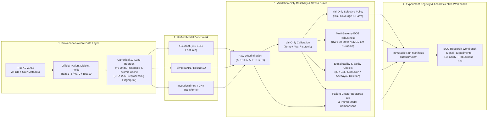
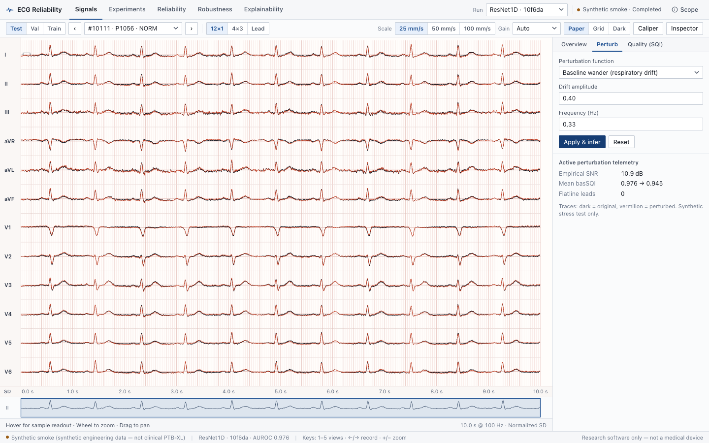
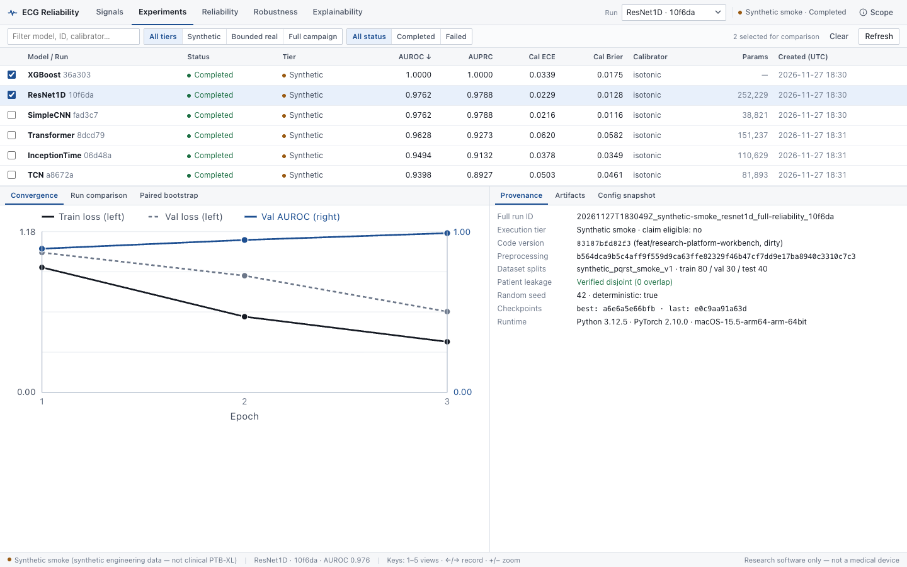
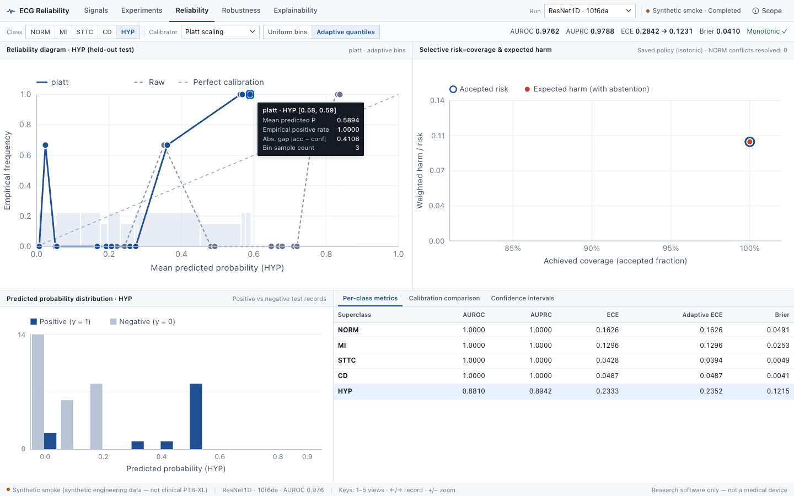
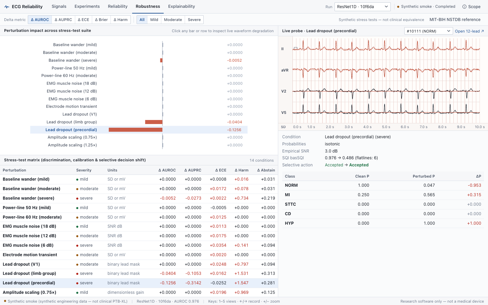
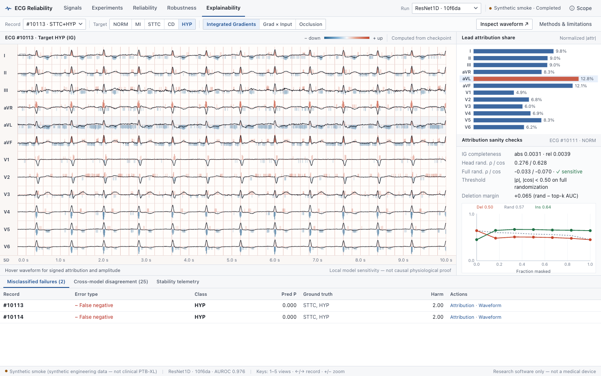

# ECG Reliability — Research Platform & Interactive Workbench (PTB-XL)

[](https://www.python.org/)
[](LICENSE)

A reproducible machine learning research platform and local interactive scientific workbench for evaluating the **reliability** of multi-label 12-lead ECG classifiers on [PTB-XL v1.0.3](https://physionet.org/content/ptb-xl/1.0.3/). Beyond headline discrimination metrics, the platform evaluates post-hoc probability calibration, harm-aware selective prediction with abstention, multi-severity ECG perturbation robustness, explanation faithfulness & sanity checks, patient-cluster statistical confidence intervals, and full experiment provenance.

> **Research software only — not a medical device.**
> This repository and its interactive workbench are scientific research instruments for ML reliability analysis. They have **not** undergone clinical validation, regulatory clearance (FDA/CE/MDR), or prospective evaluation, and **must not** be used for diagnosis, triage, screening, treatment, or clinical decision-making.

---

## Associated Publication & Research Extension Notice

This repository originated as the reproducible implementation for:

> D. Konyspayev, B. Kuzenbayev, N. Abatov, and D. Alippayeva,
> “Reliability-Aware Artificial Intelligence for Multilabel Electrocardiogram
> Diagnosis,” *Scientific Journal of Astana IT University*, vol. 27, no. 3,
> pp. 66–78, 2026. [doi:10.37943/WWSQ922](https://doi.org/10.37943/WWSQ922)

### Distinction between the published study and this research extension

- **Published study baseline**: Reported internal PTB-XL five-superclass experiments using the original stage scripts (`scripts/00_*` through `scripts/19_*`). Previously reported publication tables and claims remain attributed solely to that study.
- **Current research platform extension (`v0.2.0`)**: Preserves prior scientific fixes (including counting repeated adaptive calibration quantile boundaries once and preserving signed probability residuals for discrete/binary probability arrays) while introducing:
  - provenance-aware, atomic signal caching (`ecg_reliability/data/cache.py`);
  - patient-cluster bootstrap confidence intervals and paired model comparisons (`ecg_reliability/evaluation/bootstrap.py`);
  - multi-severity physiological ECG perturbation stress tests with MIT-BIH Noise Stress Test Database (NSTDB) reference documentation (`ecg_reliability/robustness/perturbations.py`);
  - attribution sanity checks (IG completeness, Adebayo parameter randomization, deletion/insertion faithfulness) and cross-model failure/disagreement analysis (`ecg_reliability/explainability/sanity_checks.py`, `ecg_reliability/evaluation/failure_analysis.py`);
  - an immutable, provenance-tracked experiment registry and CLI (`ecg-reliability`);
  - a local interactive 5-workspace scientific ECG Research Workbench (`ecg-reliability workbench`).

---

## Platform Architecture



---

## Scientific Safeguards & Execution Tiers

The platform strictly separates three execution tiers so engineering smoke runs can never be confused with scientific claims:

| Execution Tier | Purpose | Claim Eligible |
| --- | --- | --- |
| `synthetic_smoke` | Fast CPU verification with synthetic PQRST 12-lead waveforms and patient-clustered folds | **No** (marked in the manifests and workbench status bar) |
| `bounded_real` | Bounded subset verification on real PTB-XL v1.0.3 records | **No** (smoke/preflight gate only) |
| `full_campaign` | Complete official PTB-XL folds `1–8` (train), `9` (val), `10` (test) with artifact validation | **Yes** (subject to claim checks & clinical limitations) |

Core methodological invariants enforced in code:

- **Patient-level disjointness**: `prepare_ptbxl_index()` and `run_model_experiment()` verify zero `patient_id` overlap across `train`, `val`, and `test`.
- **Canonical lead ordering & physical units**: WFDB signals are converted to `mV` before optional per-lead z-normalization (`normalized_sd`), and leads are canonically validated/reordered to `I, II, III, aVR, aVL, aVF, V1–V6`.
- **Provenance-aware atomic caching**: `scripts/01_cache_signals.py` refuses existence-only cache reuse; cached `.npy` files are validated against a SHA-256 preprocessing fingerprint, source `.hea`/`.dat` metadata, sampling frequency, normalization flag, and lead order, and written atomically via temp file + `fsync` + `os.replace`.
- **Validation-only calibration & selective thresholds**: Calibrators (`scalar_temperature`, `vector_temperature`, `platt`, `isotonic`) and abstention coverage thresholds are fit exclusively on fold 9 (`val`) and evaluated on held-out fold 10 (`test`).
- **Statistical rigor**: Bootstrap confidence intervals support patient-cluster resampling, paired model comparisons on identical resampled clusters, and explicit reporting of CI definition, valid/invalid resample counts, and effective sample size (`N_eff`).
- **Immutability & recoverability**: Completed experiment runs cannot be overwritten (`RunOverwriteError`), failed/interrupted runs are explicitly recorded with failure telemetry, and interrupted PyTorch runs can resume from `last.pt`.

---

## Interactive ECG Research Workbench

The built-in local workbench (`ecg-reliability workbench`) reads real experimental artifacts from `outputs/runs/` and executes live perturbation, signal-quality (SQI), and model inference probes against saved checkpoints—with zero external paid services or fabricated outputs.

### Signal Explorer

Zoom with the mouse wheel, drag the waveform or use the overview strip to pan, and use the caliper to measure sample intervals and amplitude differences. The inspector includes record provenance, model probabilities, live perturbations, and per-lead signal quality.



### Experiment Explorer



### Reliability Analysis



### Robustness Lab



### Explainability and Failure Analysis



*Screenshots were captured in the live local workbench using saved `synthetic_smoke` runs. The status bar identifies the synthetic data. The displayed metrics are for engineering verification only.*

---

## Reproducible Quick Start

### 1. Install

```bash
git clone https://github.com/knspvd98/ecg-reliability-ptbxl.git
cd ecg-reliability-ptbxl

python3 -m venv .venv
source .venv/bin/activate
python -m pip install --upgrade pip
python -m pip install -e ".[dev]"
```

### 2. Verify Lint, Tests, and Legacy Smoke Pipeline

```bash
ruff check .
pytest
bash runpod/smoke_run.sh
```

### 3. Run a Multi-Model CPU Research Suite & Launch the Workbench

```bash
# Run a fast, provenance-tracked CPU synthetic benchmark across model families
ecg-reliability run-suite \
  --config configs/debug.yaml \
  --tier synthetic_smoke \
  --models xgboost,simple_cnn,resnet1d,inceptiontime,tcn,transformer \
  --override training.epochs=3 \
  --override model.hidden_dim=64 \
  --n-bootstrap 100

# Inspect recorded runs from the CLI
ecg-reliability list-runs

# Launch the local interactive workbench (opens at http://127.0.0.1:8501)
ecg-reliability workbench --host 127.0.0.1 --port 8501
```

### 4. Run on Real PTB-XL v1.0.3

Download PTB-XL v1.0.3 separately under its PhysioNet license and point the environment variable to it.

PTB-XL Plus is intentionally excluded so that the benchmark remains based on the original waveform and metadata release without derived annotations.

```bash
export PTBXL_ROOT=/absolute/path/to/ptb-xl-1.0.3

# Bounded real-data verification gate
bash runpod/smoke_real_ptbxl.sh
bash runpod/performance_smoke.sh

# Validate cache provenance fingerprint against current config
ecg-reliability validate-cache --config configs/base.yaml

# Run full claim-oriented GPU campaign
bash runpod/claim_run_ptbxl.sh
```

---

## CLI Reference (`ecg-reliability`)

| Command | Description |
| --- | --- |
| `ecg-reliability run-suite` | Run configurable suites (`discrimination,calibration,selective,robustness,explainability,bootstrap,failure_analysis` or `all`) across selected models with full provenance manifests. Supports `--resume <run_id>` for interrupted/failed runs. |
| `ecg-reliability list-runs` | Tabulate completed, failed, interrupted, and running experiments under `outputs/runs/`. |
| `ecg-reliability inspect-run <run_id>` | Output complete JSON provenance, config snapshot, checksums, and metrics for a run. |
| `ecg-reliability validate-cache` | Verify `outputs/cache/cache_provenance.json` against the current preprocessing SHA-256 fingerprint. |
| `ecg-reliability workbench` | Start the local interactive ECG Research Workbench HTTP server. |

---

## ECG Perturbation Suite & MIT-BIH NSTDB Reference

Implemented perturbations in [`ecg_reliability/robustness/perturbations.py`](ecg_reliability/robustness/perturbations.py):

- **Baseline wander**: single- and multi-harmonic respiratory/postural drift (`0.25–0.45 Hz`), amplitude documented in signal units (`SD` after z-normalization or `mV` pre-normalization).
- **Power-line interference**: sinusoidal `50 Hz` / `60 Hz` mains interference. *Physical note*: at `100 Hz` sampling rate (Nyquist = `50 Hz`), `50 Hz` sits at Nyquist and `60 Hz` aliases to `40 Hz`; full mains resolution requires `500 Hz` (`filename_hr`).
- **Muscle noise (EMG)**: 3rd-order Butterworth band-limited (`20–45 Hz`) noise calibrated to target SNR in dB (`18, 12, 6 dB`).
- **Electrode motion**: transient biphasic impedance-shift impulses mimicking ambulatory electrode slip.
- **Lead dropout & amplitude scaling**: single-lead dropout, anatomical group dropout (`limb` leads `I–aVF` or `precordial` leads `V1–V6`), and uniform gain shifts (`0.75×`, `1.25×`).

The parameterization and SNR dB scale (`24, 18, 12, 6, 0, -6 dB`) reference the PhysioNet **MIT-BIH Noise Stress Test Database (NSTDB)** (`bw`, `ma`, `em`). If a researcher supplies a local copy via `--nstdb-root`, `load_nstdb_noise_reference()` verifies its availability without downloading restricted data. Synthetic stress tests quantify model sensitivity and **do not** constitute claims of clinical robustness.

---

## Project Structure

```text
ecg_reliability/
  data/              labels, PTB-XL indexing, WFDB preprocessing, SQI/features, atomic provenance cache
  models/            XGBoost, SimpleCNN, ResNet1D, InceptionTime, TCN, Transformer
  training/          balanced BCE loss, resumable checkpoints, PyTorch & XGBoost training loops
  calibration/       scalar/vector temperature, Platt scaling, isotonic regression
  evaluation/        metrics, ECE/adaptive ECE/Brier, patient-cluster & paired bootstrap, failure analysis
  decision/          expected harm, NORM consistency rule, selective abstention policy
  robustness/        realistic ECG perturbations, severity suites, decision-layer robustness
  explainability/    IG, Gradient×Input, occlusion, stability, Adebayo & deletion sanity checks
  experiments/       immutable run registry, provenance tracking, benchmark suite runner
  workbench/         local HTTP API server, data access, and 5-workspace scientific UI
  external/          bounded Challenge-2021 binary abnormal-vs-normal sanity check
  campaign/          staged campaign runner and claim artifact validation gates
  cli.py             unified `ecg-reliability` command-line interface
scripts/             modular pipeline stage scripts (00 through 19)
configs/             base, debug, and architecture-specific YAML configurations
tests/               unit, integration, regression, leakage, cache, bootstrap, and workbench tests
runpod/              smoke and full-campaign shell orchestrators
docs/screenshots/    real screenshots captured from the local workbench
```

---

## Scientific Limitations

- **Not a medical device**: No prospective clinical study, bedside validation, or regulatory review has been performed.
- **Synthetic vs. real data**: CPU smoke suites (`synthetic_smoke`) use synthetic PQRST waveforms solely for software verification and workbench inspection; their metrics are not scientific findings.
- **External validation boundary**: The optional external branch supports a bounded binary abnormal-vs-normal sanity check on Challenge 2021-style 12-lead ECGs and does not claim PTB-XL five-superclass external validation without a reviewed SNOMED mapping.
- **Normalization & physical amplitudes**: Per-lead z-normalization removes absolute millivolt voltage cues (relevant for hypertrophy voltage criteria); disable `data.normalize_per_lead` if evaluating physical `mV` voltage sensitivity.
- **Sampling rate & Nyquist limit**: Default PTB-XL `100 Hz` (`records100`) limits spectral content to `< 50 Hz`; use `500 Hz` (`records500`) for high-frequency QRS notch or unaliased `50/60 Hz` powerline studies.
- **Post-hoc explainability**: Attribution maps reflect local model sensitivity rather than physiological causality, even when passing parameter-randomization and deletion sanity checks.
- **Harm weights**: Decision harm weights (`MI fn=2.5`, etc.) are technical research parameters, not calibrated clinical utility estimates.

---

## License

Code is released under the [MIT License](LICENSE). PhysioNet dataset rights (PTB-XL, MIT-BIH NSTDB, Challenge 2021) remain governed by their respective upstream licenses and data-use agreements.
