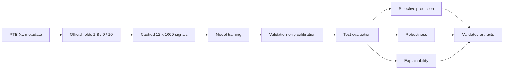

# ECG Reliability on PTB-XL

[](https://github.com/knspvd98/ecg-reliability-ptbxl/actions/workflows/ci.yml)
[](https://www.python.org/)
[](LICENSE)

An end-to-end research pipeline for evaluating the reliability of multi-label
ECG classifiers on [PTB-XL](https://physionet.org/content/ptb-xl/1.0.3/). The
project goes beyond headline discrimination metrics: it measures calibration,
selective prediction, robustness, explanation stability, and operational
performance under a reproducible split and artifact contract.

> **Research software only.** This repository is not a medical device and must
> not be used for diagnosis, treatment, triage, or clinical decision-making.

## Associated publication

This repository provides the reproducible implementation for:

> D. Konyspayev, B. Kuzenbayev, N. Abatov, and D. Alippayeva,
> “Reliability-Aware Artificial Intelligence for Multilabel Electrocardiogram
> Diagnosis,” *Scientific Journal of Astana IT University*, vol. 27, no. 3,
> pp. 66–78, 2026. [doi:10.37943/WWSQ922](https://doi.org/10.37943/WWSQ922)

The paper and this repository evaluate a reliability framework rather than
claiming a novel clinical model or production-ready diagnostic system.

## What the pipeline covers

- Five PTB-XL diagnostic superclasses: `NORM`, `MI`, `STTC`, `CD`, and `HYP`.
- XGBoost, 1D CNN, ResNet1D, InceptionTime, TCN, and Transformer models.
- Scalar/vector temperature scaling, Platt scaling, and isotonic calibration.
- Harm-aware selective prediction with abstention and coverage analysis.
- ECG perturbations: lead dropout, noise, baseline wander, and amplitude shift.
- Integrated Gradients, gradient × input, occlusion, and explanation stability.
- Bootstrap confidence intervals, model-selection manifests, and claim checks.
- Optional bounded external abnormal-vs-normal validation.

## Reliability-first design



The pipeline enforces these safeguards:

- training uses PTB-XL folds `1-8`, validation uses fold `9`, and test uses fold `10`;
- calibration, thresholds, model selection, and abstention policies use validation data only;
- patient overlap is checked before claim-bearing runs;
- synthetic smoke outputs are explicitly separated from real-data results;
- external evaluation cannot silently claim the internal five-superclass task;
- figures and summaries require an explicit model-selection manifest.

## Quick start

```bash
git clone https://github.com/knspvd98/ecg-reliability-ptbxl.git
cd ecg-reliability-ptbxl

python3 -m venv .venv
source .venv/bin/activate
python -m pip install --upgrade pip
python -m pip install -e ".[dev]"
```

Run the unit tests and the synthetic end-to-end smoke pipeline:

```bash
ruff check .
pytest
bash runpod/smoke_run.sh
```

The smoke pipeline creates synthetic ECG-like arrays and verifies training,
evaluation, calibration, selective prediction, robustness, explainability,
figures, and summary generation. Its metrics are integration-test outputs, not
scientific results.

## Run on PTB-XL

Download PTB-XL v1.0.3 separately and point the project to it:

PTB-XL Plus is intentionally excluded so that the benchmark remains based on
the original waveform and metadata release without derived annotations.

```bash
export PTBXL_ROOT=/absolute/path/to/ptb-xl-1.0.3
bash runpod/smoke_real_ptbxl.sh
bash runpod/performance_smoke.sh
```

The real-data proof gate must create all three artifacts before a full run:

- `outputs/index/index_summary.json`
- `outputs/cache/cache_summary.json`
- `outputs/summary/results_summary.json`

Start the full claim-oriented campaign with:

```bash
bash runpod/claim_run_ptbxl.sh
```

See [`configs/base.yaml`](configs/base.yaml) for the complete data, training,
calibration, decision, robustness, explainability, and external-validation
configuration.

## Pipeline stages

| Stage | Entry point | Main output |
| --- | --- | --- |
| Index PTB-XL | `scripts/00_prepare_ptbxl.py` | validated fold and label index |
| Cache signals | `scripts/01_cache_signals.py` | normalized NumPy arrays and manifest |
| Train models | `scripts/02_*`, `03_*` | checkpoints and runtime reports |
| Evaluate | `scripts/04_eval_model.py` | predictions and classification metrics |
| Calibrate | `scripts/05_fit_calibration.py` | fitted calibrators and ECE/Brier metrics |
| Selective policy | `scripts/06_eval_selective_policy.py` | risk-coverage and harm summaries |
| Robustness | `scripts/07_eval_robustness.py` | perturbation degradation tables |
| Explainability | `scripts/08_generate_explanations.py` | attribution and stability artifacts |
| Figures and reports | `scripts/09_*`, `10_*`, `15_*` | figures, tables, and result summaries |
| Claim validation | `scripts/14_validate_claim_artifacts.py` | machine-readable readiness report |

## Project structure

```text
ecg_reliability/
  data/              label mapping, indexing, preprocessing, cached dataset
  models/            XGBoost and neural architectures
  training/          losses, checkpoints, and training loops
  calibration/       post-hoc calibration methods
  evaluation/        metrics, bootstrap, thresholding, and reports
  decision/          abstention, harm, and label-consistency policies
  robustness/        ECG perturbations and degradation evaluation
  explainability/    attribution methods and stability analysis
  external/          bounded external-validation workflow
  campaign/          staged run manifests and artifact gates
scripts/              command-line pipeline stages
configs/              base, debug, and model-specific configurations
tests/                unit and integration tests
runpod/               reproducible smoke and full-run orchestration
```

## Reproducibility and data policy

- Dataset files, cached signals, predictions, checkpoints, and generated reports
  are intentionally excluded from Git.
- Random seeds and runtime configuration are captured in the output artifacts.
- The code records device, package versions, throughput, and memory information.
- PTB-XL remains subject to its original PhysioNet license and terms of use.

## External validation boundary

The optional external branch supports an abnormal-vs-normal sanity check on
Challenge 2021-style 12-lead ECG sources. It does **not** claim direct external
validation of the PTB-XL five-superclass task unless an explicit, reviewed
SNOMED mapping is supplied.

## Current limitations

- No clinical validation or prospective evaluation has been performed.
- Performance depends on the selected architecture, hardware, and dataset copy.
- The Transformer path is experimental and excluded from the first
  claim-bearing campaign by default.
- Harm weights are technical evaluation weights, not clinical utility estimates.

## License

Code is released under the [MIT License](LICENSE). Dataset rights are not
included.
